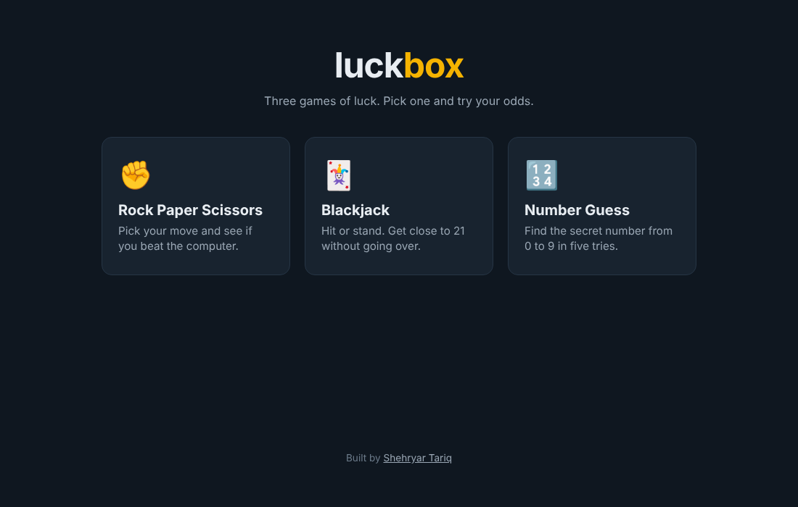
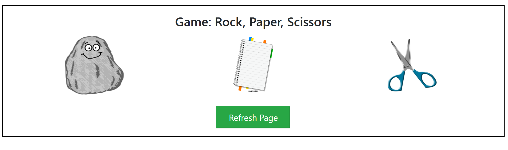
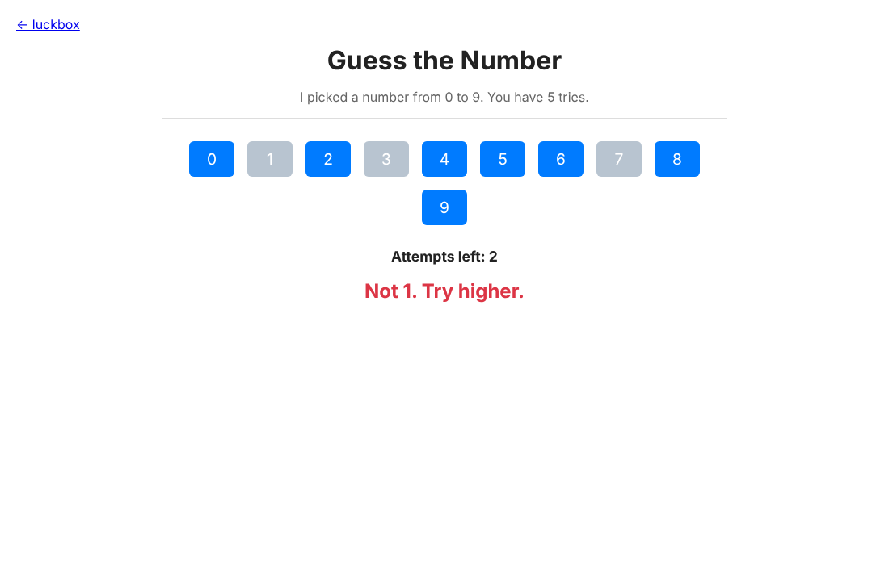

# luckbox

Three games of luck that run in the browser: **Rock Paper Scissors**, **Blackjack** and **Number Guess**. No install, no build step. Just HTML, CSS and JavaScript.



## The games

| Game | How to play |
| --- | --- |
| [Rock Paper Scissors](./rock-paper-scissors) | Pick rock, paper or scissors. The computer picks at random and the winner is shown right away. |
| [Blackjack](./blackjack) | Hit to draw cards, Stand to let the dealer play. Get closer to 21 than the dealer without going over. Wins, losses and draws are counted across rounds. |
| [Number Guess](./number-guess) | The computer picks a number from 0 to 9. You get 5 tries, with a higher or lower hint after each miss. |

## Screenshots

| Rock Paper Scissors | Number Guess |
| --- | --- |
|  |  |

## Tech stack

- HTML5 and CSS3
- Vanilla JavaScript (ES6), no frameworks
- Bootstrap 4 for the Rock Paper Scissors and Blackjack layouts
- Sound effects in Blackjack with the Web Audio `Audio` API

## Run it locally

```bash
git clone https://github.com/Shahryartariq/luckbox.git
cd luckbox
python3 -m http.server 8000
```

Then open http://localhost:8000. You can also open `index.html` directly in a browser.

## Project structure

```
luckbox/
├── index.html              # Home page that links to each game
├── rock-paper-scissors/
├── blackjack/
└── number-guess/
```

Each game folder is self-contained with its own `index.html`, styles and script.

## Author

**Muhammad Shehryar Tariq**, full stack developer
[Portfolio](https://shehryar-tariq.dev) · [GitHub](https://github.com/Shahryartariq)

## License

MIT. See [LICENSE](./LICENSE).
