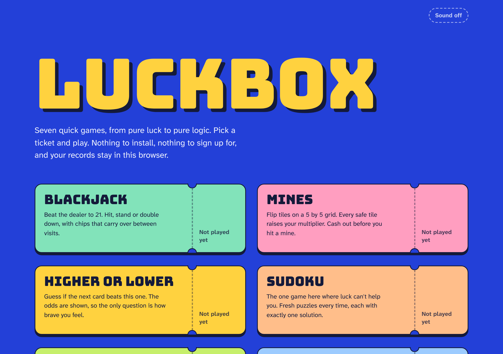
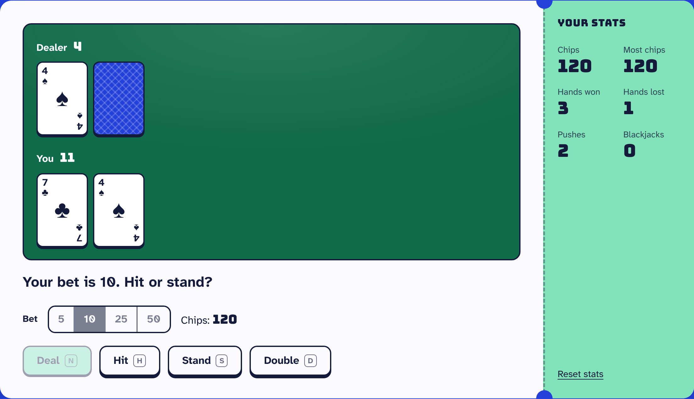
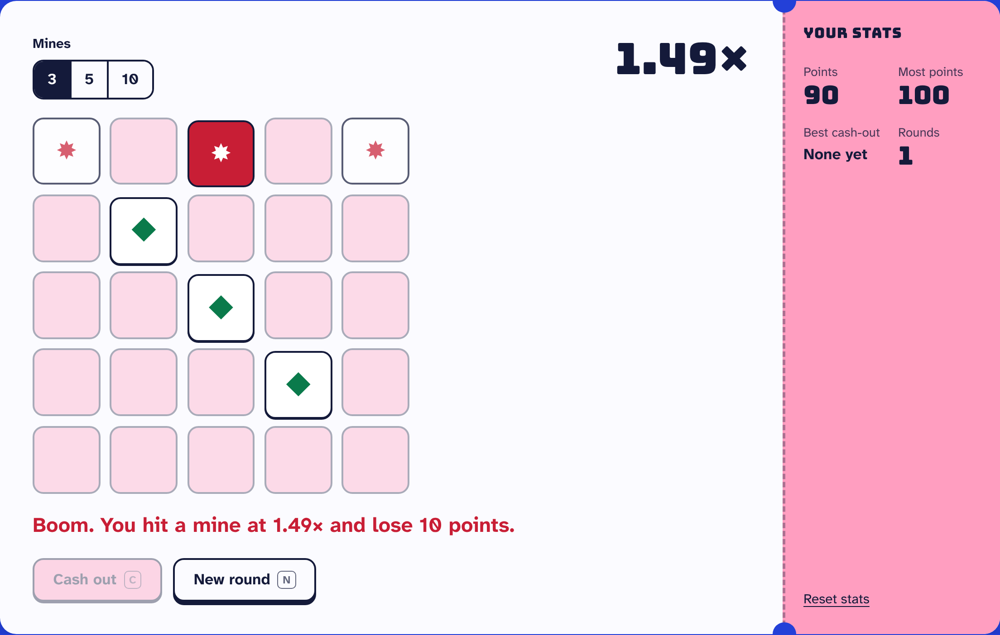
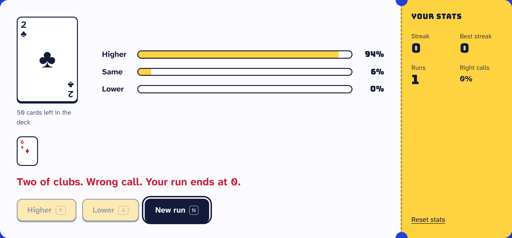
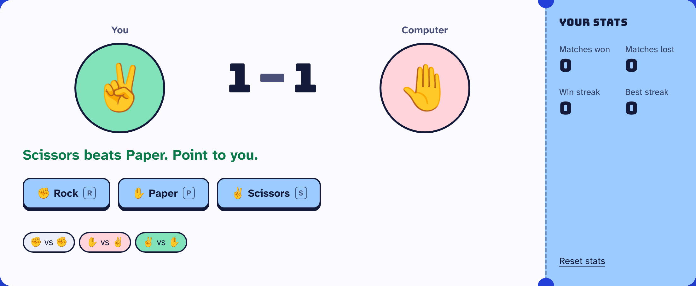
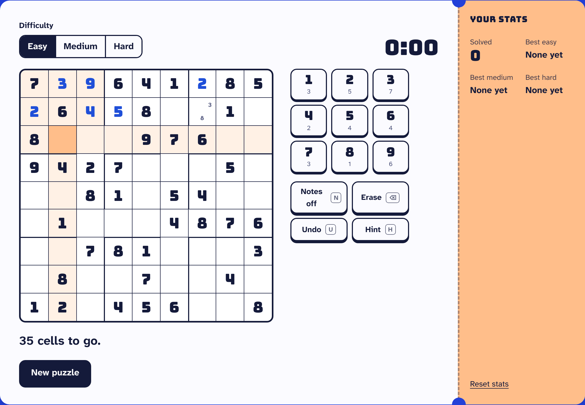
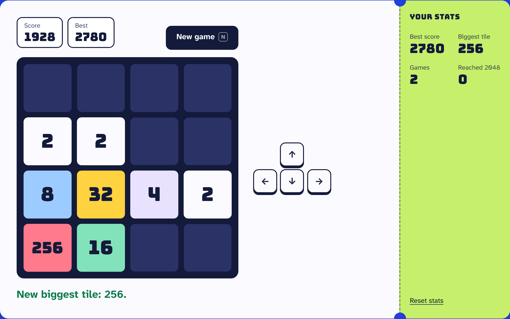
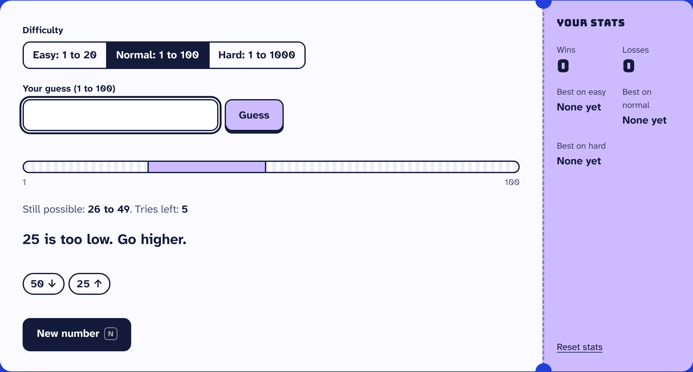

# luckbox

Seven quick browser games, from pure luck to pure logic: **Blackjack**, **Mines**, **Higher or Lower**, **Sudoku**, **2048**, **Rock Paper Scissors** and **Number Guess**. Free, no sign-up, and your records stay in your browser.

**Play it:** https://playluckbox.vercel.app



## The games

| Game | What you do |
| --- | --- |
| **Blackjack** | Bet, then hit, stand or double down against a dealer who stands on 17. Four-deck shoe, blackjack pays 3 to 2, chips carry over between visits. |
| **Mines** | Flip tiles on a 5×5 board with 3, 5 or 10 hidden mines. Each safe tile raises a fair multiplier. Cash out before you hit a mine. |
| **Higher or Lower** | Call the next card. The live odds come from the cards still in the deck. One wrong call ends the run. |
| **Sudoku** | Easy, medium or hard puzzles generated in your browser, each with exactly one solution. Notes, undo, hints, clash highlighting, a timer and best times. Leave mid-puzzle and it's still there when you come back. |
| **2048** | Slide and merge tiles with the arrow keys, WASD, a swipe or the on-screen arrows. Smooth slide and merge animations, best score and biggest tile saved, and your game resumes where you left it. |
| **Rock Paper Scissors** | First to three wins the match. Win streaks are tracked. |
| **Number Guess** | Easy (1–20), Normal (1–100) or Hard (1–1000). A range bar shows what is still possible after each guess. |

| Blackjack | Mines |
| --- | --- |
|  |  |
| **Higher or Lower** | **Rock Paper Scissors** |
|  |  |
| **Sudoku** | **2048** |
|  |  |
| **Number Guess** | |
|  | |

## Features

- **Keyboard play** in every game (keys are shown on the buttons), plus arrow keys to move around the Mines and Sudoku boards, and swipe to play 2048 on a phone
- **Saved stats** per game in `localStorage`, shown on the home page tickets. Missing or broken storage never stops a game
- **Sound effects** made with the Web Audio API, so there are no audio files to download. One toggle, remembered
- **Accessible:** screen-reader announcements for every result, visible focus, reduced-motion support, and automated axe checks against WCAG 2.2 AA on every page
- **Fair randomness** from `crypto.getRandomValues`, with Fisher-Yates shuffles
- **Small:** no framework, self-hosted fonts, and under 7 KB of gzipped JavaScript per page

## Tech stack

- TypeScript (strict), no UI framework
- Vite multi-page build
- Vitest for game rules, Playwright for browser tests on desktop and mobile, axe-core for accessibility
- ESLint with typescript-eslint
- GitHub Actions CI; deployed on Vercel with security headers and a strict Content Security Policy

## How it's built

Each game has two files: `logic.ts` holds the rules with no DOM code, and `main.ts` draws the game and handles input. The rules take a random number generator as a parameter, so tests can replay exact games from a seed.

```
src/
├── games/
│   ├── blackjack/          # logic.ts, logic.test.ts, main.ts, style.css
│   ├── mines/
│   ├── higher-or-lower/
│   ├── sudoku/
│   ├── 2048/
│   ├── rock-paper-scissors/
│   └── number-guess/
├── shared/                 # cards, randomness, storage, sound, page shell
├── styles/base.css         # design tokens and shared components
└── home/                   # home page
tests/e2e/                  # Playwright tests that play every game
```

Some of what the tests check:

- Blackjack: soft aces, dealer rules, payouts, and that chips stay correct over 300 simulated hands
- Mines: the multiplier is fair (chance of surviving × payout = 1 at every step)
- Number Guess: binary search always wins inside the try limit
- Higher or Lower: the odds match a hand count of the deck
- Sudoku: every generated puzzle has exactly one solution and the right number of clues
- 2048: merges happen once per tile per move in every direction, and the score always equals the sum of merges
- In the browser: a full match or hand of every game, accessibility, no sideways scrolling on phones, and no console errors

## Run it locally

Requires Node.js 20.19 or newer.

```bash
git clone https://github.com/Shahryartariq/luckbox.git
cd luckbox
npm install
npm run dev
```

Then open http://localhost:5173.

| Command | What it does |
| --- | --- |
| `npm run dev` | Start the dev server |
| `npm run build` | Typecheck and build to `dist/` |
| `npm test` | Run the unit tests |
| `npm run test:e2e` | Build, serve and run the browser tests (run `npx playwright install chromium` once first) |
| `npm run check` | Lint, typecheck, unit tests and build |

## Author

**Muhammad Shehryar Tariq**, full stack developer. [Portfolio](https://shehryartariq.vercel.app), [GitHub](https://github.com/Shahryartariq).

## License

MIT. See [LICENSE](./LICENSE).
